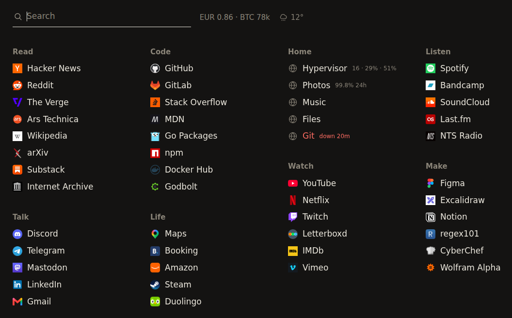

# newtab

A self-hosted browser start page for Linux servers and Docker: your links on one screen, filtered
as you type.

[](https://github.com/eeegoloauq/newtab/releases/latest)
[](https://github.com/eeegoloauq/newtab/actions/workflows/ci.yml)
[](LICENSE)



- Links from one YAML file
- Service status from an uptime monitor
- Weather and exchange rates, no accounts
- Guests, CPU and memory from Proxmox
- New tab extension for Chrome and Firefox
- Loads nothing from other servers

## Download

Get the [latest release](https://github.com/eeegoloauq/newtab/releases/latest).

## Usage

```sh
./newtab demo                        # the page above, with made-up data
cp config.example.yaml config.yaml   # your links go here
./newtab run config.yaml
```

[Configuration](docs/configuration.md) · [Server setup](docs/server.md) · [Start page and new tab](docs/browser.md)

## Development

[Build and test](docs/development.md) · [Rejected designs](docs/design.md) · [Roadmap](ROADMAP.md)

## License

[MIT](LICENSE)
