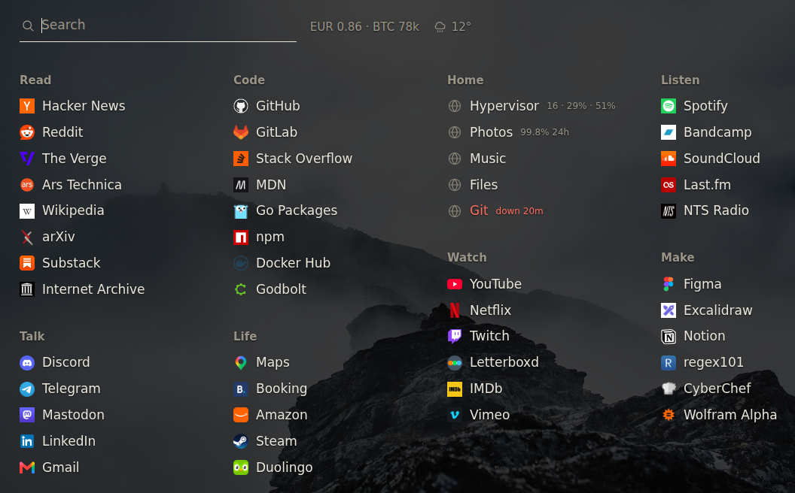

# Configuration

## First run

```sh
go build ./cmd/newtab
./newtab demo                        # the page above, with made-up data

cp config.example.yaml config.yaml   # your links go here
./newtab validate config.yaml
./newtab run config.yaml
```

`run` downloads each site's icon into `icon_dir` in the background and serves it from disk after
that. Sites without an icon get a globe. A file you put in `icon_dir` yourself is used instead of
the downloaded one.

## Links and search

```yaml
sections:
  - name: Read
    style: list
    links:
      - name: Hacker News
        url: https://news.ycombinator.com/
        alias: [hn]          # also matches when you type this
        pin: true            # first in its section
```

```yaml
search:
  engine: https://duckduckgo.com/?q=%s
```

Enter opens the highlighted link; if none matches, it searches with the configured engine.

`style: list` is for bookmarks. `style: live` is for services, and their rows can show status
from a monitor. Full example: [config.example.yaml](../config.example.yaml).

## Looks

Colours, type size, columns and a background image are config:

```yaml
columns: 4
theme:
  background: "#141312"     # any of these can be left out
  ink: "#e8e4da"
  muted: "#8a8478"
  font_size: 17
  image: /var/lib/newtab/hills.jpg
  image_dim: 0.75           # validate measures the picture and says if this is too low
```



`newtab demo -config yours.yaml` renders your config with made-up status, so you can see the
background and a row that is down.

## Rates

```yaml
rates:
  base: USD
  fiat: [EUR, GBP]     # one USD in each
  crypto: [BTC, ETH]   # priced in USD
  every: 30m
```

Shown next to the search field as `EUR 0.86 · BTC 78k`. Currencies come from
[open.er-api.com](https://open.er-api.com/), crypto from Coinbase's public spot price. No
accounts needed.

## Weather

```yaml
weather:
  latitude: 59.9386
  longitude: 30.3141
  every: 15m
```

Temperature and an icon next to the search field, from [Open-Meteo](https://open-meteo.com/). No
account or key needed.

## Status from a monitor

Rows can show status from [lookout](https://github.com/eeegoloauq/lookout), an uptime monitor.
Other monitors work through a small script that serves the same JSON (below), for example in front
of Uptime Kuma or Gatus.

```yaml
status:
  url: http://monitor.example/api/status
  every: 30s
  tail: problems
```

A row is matched to a check by host, or by `check:` on the link. A down row shows how long it has
been down. A healthy row shows what `tail` selects:

| `tail` | a healthy row shows |
|---|---|
| `problems` (default) | nothing, until the last day was less than perfect — then `99.8% 24h` |
| `latency` | the last probe, `23 ms` |
| `uptime24h`, `uptime7d` | that figure, always |
| `never` | nothing, ever |

The fields newtab reads:

```json
{"version": 1, "checks": [
  {"name": "Photos", "url": "https://photos.example.com/", "status": "up",
   "muted": false, "last_probe": {"duration_ms": 21},
   "uptime_24h": {"ratio": 0.9982}, "incident": null}
]}
```

newtab only reads this endpoint and polls it on its own schedule.

## Proxmox

```yaml
proxmox:
  url: https://hypervisor.example.com:8006
  token_env: NEWTAB_PROXMOX_TOKEN   # user@realm!id=secret, from the environment
  attach: Hypervisor                # the link whose row shows them
  insecure: true                    # it answers with its own certificate
```

The row shows `16 · 29% · 51%`: running guests, CPU and memory, with labels on hover. The token
needs the `PVEAuditor` role and is read from the environment, not from the config.
